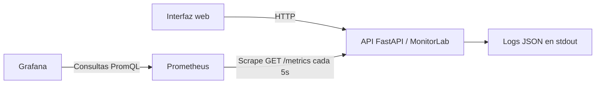

# Demo: Monitoreo de aplicaciones en MonitorLab

API educativa + instrumentación de métricas + Prometheus + Grafana + alerta.

## Requisito

**Solo Docker Desktop** con el motor iniciado (Engine running). No es necesario instalar Python en Windows, Grafana ni Prometheus por separado.

## Cómo arrancar (Windows, PowerShell)

1. Descomprime el ZIP. Abre la carpeta `monitorlab-monitoreo` en Visual Studio Code.
2. En VS Code: menú **Terminal > New Terminal**.
3. Desde la raíz de la carpeta ejecuta:

   ```powershell
   docker compose up -d --build
   ```

   La primera ejecución descarga imágenes. Requiere internet.
4. Para verificar:

   ```powershell
   docker compose ps
   ```

   Deben verse **app**, **prometheus** y **grafana** con estado `Up` o `running`.
5. Abre:
   - **http://localhost:8000**: demo interactiva con 4 botones.
   - **http://localhost:3000**: Grafana. Usuario `admin`, clave `admin` (solo demo local). Abre **Dashboards > MonitorLab > MonitorLab · Monitoreo de Aplicaciones**.
   - **http://localhost:9090/targets**: confirma que `monitorlab` está **UP**.
   - **http://localhost:9090/alerts**: alerta de más de 3 errores HTTP 500 en 1 min.
   - **http://localhost:8000/docs**: documentación Swagger de la API.

## Presentación: recorrido recomendado (5–8 min)

1. Abre la página de la demo y el dashboard de Grafana en pestañas separadas.
2. Clic **Generar 24 consultas**. Muestra los códigos HTTP 200 y el tráfico normal en Grafana.
3. Clic **Generar 10 consultas lentas**. Tardan unos segundos por lote: vuelve a Grafana y observa cómo sube la **latencia p95**.
4. Clic **Generar 16 errores**. Vuelve a Grafana y observa subir el **porcentaje de errores**. Abre `http://localhost:9090/alerts` y observa la alerta `MonitorLabErroresAltos` si está activa.
5. Abre los logs con `docker compose logs app --tail 60` y explica la correlación entre el estado HTTP 500 y el registro `operacion_error_simulado`.
6. Explica que los errores y las demoras son **simulados en la aplicación de demo**, pero las peticiones HTTP, métricas recolectadas, logs y visualizaciones son reales.

La recolección ocurre cada **5 segundos**. El gráfico de Prometheus calcula tasas de una ventana de **1 minuto**, por lo que puede tardar unos segundos en aparecer y estabilizarse. Si te demoras mirando el panel, el pico de errores puede dejar de cumplir la alerta de `1m`; vuelve a generar errores.

## Evidencias para el informe

- Captura 1: UI con resultados normales y gráfico de tráfico.
- Captura 2: UI con consultas lentas y gráfico de latencia p95.
- Captura 3: UI con errores y gráfico de tasa de errores.
- Captura 4: Prometheus /alerts con la alerta activa.
- Captura 5: consola con `docker compose logs app --tail 60`.
- Captura 6: `docker compose ps` y /targets en estado UP.

## Arquitectura



La API usa `prometheus-client` para contar solicitudes por estado y registrar duración en un histograma. Prometheus consulta `/metrics` cada 5s y evalúa una alerta. Grafana usa PromQL para mostrar tasa de solicitudes, tasa de error y percentil 95 de latencia.

## Aplicabilidad y trade-offs

**Conviene** cuando se requieren indicadores de servicio para detectar regresiones, errores y lentitud. **No conviene** desplegar toda una pila de monitoreo para un script local de uso ocasional. Ventajas: diagnósticos más rápidos, métricas históricas y alertas; costos: infraestructura adicional, almacenamiento, configuración, ruido de alertas y posible cardinalidad elevada si se utilizan IDs de usuario como etiquetas. Esta demo usa patrones de ruta para limitar cardinalidad. En producción, usar autenticación, retención, almacenamiento persistente y controles de acceso; las credenciales `admin/admin` son solo para uso local.

**Alternativas:** logs simples (menos infraestructura, no tendencias cuantitativas), plataformas APM administradas (menos mantenimiento, costo recurrente) y OpenTelemetry con un collector y backend de trazas (seguimiento entre servicios, mayor complejidad).

## Solución de problemas

- Comprueba que Docker Desktop diga **Engine running**.
- Si la terminal dice `docker: command not found`, cierra y vuelve a abrir VS Code.
- Si aparece un error de puerto ocupado, revisa si otro programa usa `3000`, `8000` o `9090`.
- Si no hay datos en Grafana, revisa `http://localhost:9090/targets`; espera el siguiente ciclo de 5 s y vuelve a generar solicitudes.
- Para revisar los logs: `docker compose logs app --tail 60`.
- Para reiniciar: `docker compose restart`.
- Para apagar: `docker compose down`.

## Archivos principales

- `app/main.py`: API y métricas.
- `app/index.html`: interfaz visual para generar tráfico y errores.
- `monitoring/prometheus/prometheus.yml`: scraping.
- `monitoring/prometheus/alerts.yml`: regla de alerta.
- `monitoring/grafana/dashboards/monitorlab.json`: dashboard precargado.
- `docker-compose.yml`: levanta todos los servicios.

**Nota:** Esta demo es independiente y no requiere un proyecto grupal. Para entregas académicas, publica el código en el repositorio que corresponda según las indicaciones del curso.


### Contraste de alerta (1 error frente a 16)

La página principal incorpora los botones **Generar 1 error** y **Generar 16 errores**. La regla `MonitorLabErroresAltos` se activa si el incremento estimado de errores HTTP 500 durante el último minuto supera 3. Para una prueba limpia, espera más de 1 minuto después de las ejecuciones anteriores, confirma en Prometheus que la alerta esté `Inactive`, genera 1 error y comprueba que sigue `Inactive`. Luego genera 16 errores y comprueba que cambie a `Firing` tras el siguiente scrape/evaluación. Debido a la extrapolación de `increase()` en ventanas cortas y al muestreo, valores próximos al umbral podrían diferir del conteo entero exacto.
